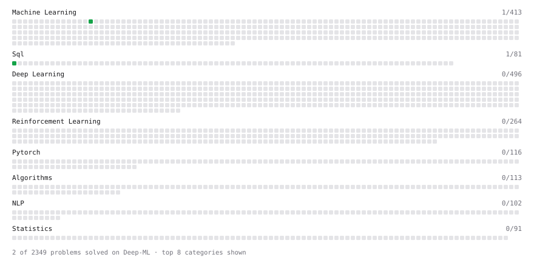

# Deep-ML

My machine learning practice from [Deep-ML](https://www.deep-ml.com). Every solution here was written by hand.

**3** solved · 3 problems · 0 labs · 0 math

[**Browse the interactive portfolio**](https://ramnallapati.github.io/deep-ml/) to replay this filling in over time.

## Problems

| | Difficulty | Solved | |
| --- | --- | --- | --- |
| [Calculate Accuracy Score](https://www.deep-ml.com/problems/36) | easy | 2026-11-19 | [solution](problems/0036-calculate-accuracy-score) |
| [First Look at a Table: Shape, Types, Missing Values and Unique Counts](https://www.deep-ml.com/problems/2319) | easy | 2026-11-19 | [solution](problems/2319-first-look-at-a-table-shape-types-missing-values-and-unique-counts) |
| [SELECT all rows](https://www.deep-ml.com/problems/1101) | easy | 2026-11-19 | [solution](problems/1101-select-all-rows) |

---

_This file is regenerated by Deep-ML on every push._
